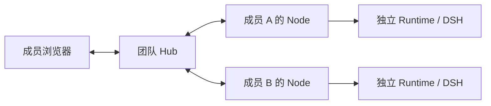

# WhalePod

WhalePod 是面向 **3–10 人小团队**的 DeepSeek Harness（DSH）多人协作发行版，让成员与各自的 Agent 围绕共同项目工作，在个人可控的环境中执行，把进展、依据和成果带回团队。

我们希望解决的是：当每个人都在使用 AI 工作时，团队如何持续知道**项目走到哪里、哪些依据变了、谁的工作受到影响、下一步在等谁**。协调信息应从正常讨论、资料修改与 Agent 工作中形成，成员无需再维护一套日报或上下文台账。

**当前处于 Alpha 开发阶段。** 任务执行、审批、成果审阅与交接已有实现和生产装配验收；持续项目协调正在兼容验证与架构评审阶段，真实办公来源接入和真人协作收益仍待验证。

## 从这里开始

- **安装试用**：[安装指南](./docs/installation.md)，包含固定试用版本、Hub 部署、个人 Node 配对、模型配置及升级恢复步骤。`main` 用于开发，试用按指南选择固定版本。
- **了解下一阶段**：[项目上下文与多人 Agent 协调计划](./docs/agent/2026-10-30-project-context-coordination-plan.md)。
- **查看实现和验证范围**：[验收文档索引](./docs/agent/README.md)；真人试用按[内部体验手册](./docs/agent/delivery-loop-internal-trial.md)记录。
- **参与开发**：先读 [AGENTS.md](./AGENTS.md) 和 [贡献指南](./CONTRIBUTING.md)。

## 现在可以做什么

- **围绕项目分工**：建立团队、项目与任务，明确真人责任人，配置团队共享的 Agent 角色。
- **在自己的环境里执行**：配对个人 Node、登记私有 Workspace，启动、追问、取消、重跑或续跑 Agent；工具动作按执行策略进入一次性审批。
- **了解允许共享的进展**：查看运行状态、脱敏活动、审批等待和个人待办，原始 Session 与私有执行目录留在成员本地。
- **把成果交给同事继续工作**：发布准确版本的 Artifact，批注、冻结修订意见、执行修订并人工复核；跨任务交接时保留约定、材料和来源版本。

交付链的机器证据见[生产装配验收](./docs/agent/delivery-loop-acceptance.md)与[成果依据验收](./docs/agent/delivery-basis-acceptance.md)。其中模型出口使用确定性回放，不能据此推导真实模型质量或团队效率。

## 当前开发进度

> 更新日期：2026-11-02。以下按本仓库实现与验收记录区分交付范围。

| 方向 | 当前状态 | 依据与下一步 |
|---|---|---|
| 多人执行与成果交付 | 已实现任务、运行、审批、固定输入、审阅修订与交接，有生产装配验收 | [交付闭环](./docs/agent/delivery-loop-acceptance.md)；继续真人试用和发布级验证 |
| 外部来源生命周期（PC-02a） | 协议、数据库与 Hub 后端已实现绑定、暂停、恢复、撤销、采集租约及权限重验 | [来源验收](./docs/agent/project-source-lifecycle-acceptance.md)；真实 Node 适配器、来源页面及正文修订链尚未交付 |
| 协调计算兼容性（PC-00） | 已验证 rc.8 的单个工具行禁用、输入引用进入模型请求与结构化结果交付机制 | [兼容探针](./docs/agent/2026-11-01-pc00-rc8-coordination-compat-acceptance.md)；尚未建立协调专用工具隔离与运行装配 |
| 持续项目协调 | ADR-0025～0027 已采纳（2026-11-02）；内部最小协调链开始实施（#472/#473/#474），线程订阅、外部来源与终态清理仍待交付 | [开发计划](./docs/agent/2026-10-30-project-context-coordination-plan.md)；先用平台内事件跑通，再接真实来源 |
| 真实办公来源与协作收益 | 普通群讨论、云文档/表格接入及真人效率对照仍未验证 | [飞书只读探针准备](./docs/agent/2026-11-01-feishu-readonly-probe-prep.md)；等待真实租户与应用授权，按试用记录判断收益 |

## 下一阶段：持续理解项目，协调人与 Agent

下一阶段要跑通：**正常工作产生变化 → 更新项目理解 → 找到受影响工作 → 相关成员处理 → 新执行采用新版依据 → 成果回到项目理解**。

例如，A 在原预算资料中把 12 万改为 8 万，B 的 Agent 正在做场地方案。目标是让 WhalePod 自动记录新版本，指出哪些工作仍采用旧预算，并在 B 正常发起下一次执行时准备新依据。项目概览同时说明“预算已调整、场地待重估”，展示出处、更新时间与未知项；A 无需再填一份协调表。这是待交付场景。

实现会优先验证持续协调、线程订阅、有界上下文读取和真实消费，再扩展资料来源。飞书为首个接入候选，钉钉、企业微信保留替换可能；首轮需要真实群讨论及至少一种云文档或表格。订阅和来源绑定只提供上下文，不自动授予业务执行权限。

方向与取舍见[阶段计划](./docs/agent/2026-10-30-project-context-coordination-plan.md)和 [dsh-superagent-prototype 复用分析](./docs/agent/2026-11-01-superagent-reuse-analysis.md)。已采纳架构见 [ADR-0025 来源修订与项目理解](./docs/adr/0025-source-revisions-and-project-understanding.md)、[ADR-0026 协调生命周期与成本](./docs/adr/0026-project-coordination-lifecycle-and-cost.md)、[ADR-0027 项目上下文快照与消费](./docs/adr/0027-run-project-context-snapshot-and-consumption.md)；内部最小链按 #472/#473/#474 交付。

## 系统如何组成



- **Hub** 持有团队、项目、任务、权限、运行状态和已发布成果，以 PostgreSQL 保存团队事实。
- **Node** 运行在成员自己的设备上，管理私有 Workspace、凭据与 Runtime 生命周期。
- **Runtime** 是每次 Run 的独立进程，由 DSH 提供 Agent 执行及插件能力。团队可见进展由按受众脱敏的投影提供，原始 DSH Session 不上传 Hub。

## 阅读顺序

下面保留第一阶段的完整设计阅读顺序；新增协调能力以阶段计划、对应 ADR 与验收记录为入口。

| 顺序 | 文档 | 用途 |
|---|---|---|
| 1 | [CONTEXT.md](./CONTEXT.md) | 统一 Team、Task、Run、Workspace 等领域语言 |
| 2 | [01-产品与架构设计.md](./01-产品与架构设计.md) | 理解产品闭环、架构、取舍和阶段边界 |
| 3 | [02-第一阶段实施计划.md](./02-第一阶段实施计划.md) | 开发 Agent 可逐项执行的代码级计划 |
| 4 | [03-领域模型与运行协议.md](./03-领域模型与运行协议.md) | 数据模型、状态机、权限和 Hub↔Node↔Runtime 协议 |
| 5 | [04-验收矩阵与测试策略.md](./04-验收矩阵与测试策略.md) | 两用户、多 Agent、审批、隔离、恢复的可证伪验收 |
| 6 | [05-里程碑与Issue拆分.md](./05-里程碑与Issue拆分.md) | 工作包、依赖、并行方式和交付门禁 |
| 7 | [06-风险与升级策略.md](./06-风险与升级策略.md) | DSH 预览版、插件安全、性能和开源治理风险 |
| 8 | [07-资料与版本基线.md](./07-资料与版本基线.md) | 官方资料、依赖版本和研究快照 |
| 9 | [docs/adr](./docs/adr/) | 难以逆转的架构决策 |

## 第一阶段交付定义

第一阶段的核心命题是：**两名以上成员能围绕一个 Task，让不同 Agent 在各自受控的 Workspace 中运行，并安全地观察、审批、接管和交付结果。** 对应用户路径如下；具体实现和已验证边界以上述验收记录为准。

1. 用 Docker Compose 启动一个单 Team 实例。
2. 创建 Owner，邀请第二名成员登录。
3. 创建 Project、Task 和两个团队 Agent（Builder、Reviewer）。
4. 在成员电脑上配对一个 Device Node，并登记一个私有 Workspace。
5. 由 Task 责任人启动 Builder Run；另一成员实时看到脱敏进度。
6. 在高风险工具执行前，由 Workspace 拥有人完成一次性批准或拒绝。
7. Agent 通过 WhalePod 提供的 DSH 工具提交 Artifact，责任人发布给 Project。
8. Reviewer Agent 基于已发布 Artifact 发起第二个 Run 并给出复核结果。
9. 由 Task 责任人提交验收并显式标记完成，Agent 不自动关闭 Task。
10. 对运行执行取消、失败重跑，并保留 `rerunOfRunId` 血缘。
11. 在 Hub 重启、Node 短暂断线后依靠事件序号和幂等写入恢复一致状态。

## 明确边界

本仓库独立开发，不迁移或兼容旧版的代码、API 与数据库。第一阶段采用以下已经拍板的范围：

- 一个部署实例只承载一个 Team；无多租户、计费和企业组织树。
- 所有 Team 成员可见所有 Project；第一阶段没有 Project 私有 ACL。
- Agent 是 Team 共享的长期角色；Workspace、Device、凭据属于成员个人。
- 原始 DSH Session 只留在 Run 责任人的 Node 本地，不上传 Hub；责任人在 Web 也只看到经脱敏的 owner-only 投影，其他成员不获得绝对路径或完整工具参数。
- Project 成员看到 Run 的状态、脱敏活动、审批等待和已发布 Artifact。
- DSH 插件兼容先覆盖 Host/Tool/Skill/MCP/模型插件；DSH 前端插件兼容不进第一阶段。
- 第三方插件不进入 Hub 进程；所有 DSH Runtime 都是独立子进程。
- Web-first；桌面壳、原生移动端，以及内建协作文档、表格、邮件、白板均不在第一阶段。
- 第一阶段只提供 `whalepod-hub` / `whalepod-node` 运维 CLI 和机器可驱动 HTTP/WS 契约；人类协作用的统一 `whalepod` CLI 在闭环证明后补上，本阶段不为了表面“CLI 对齐”扩大验收面。
- PostgreSQL 是唯一团队数据库；不引入 Redis、Celery、Kafka 或 Kubernetes。

## 开发与验证

开发环境使用 Node.js 24，pnpm 版本以 [package.json](./package.json) 的 `packageManager` 为准。首次克隆后：

```sh
bash scripts/install-hooks.sh
pnpm install --frozen-lockfile
pnpm check
```

后续按改动运行相关质量门；数据库与故障测试需要真实 PostgreSQL，浏览器验收还需对应环境。完整命令和适用范围见 [AGENTS.md](./AGENTS.md)，复跑入口与证据位置见[验收索引](./docs/agent/README.md)和[取证地图](./docs/agent/evidence-map.md)。

新增工作先登记并认领 Issue，使用短生命周期分支，通过 PR 合入；提交带 DCO sign-off。具体流程以[贡献指南](./CONTRIBUTING.md)和仓库 Skill 为准。

## 使用规则

- 第一阶段实现与交付定义保留在 [02-第一阶段实施计划.md](./02-第一阶段实施计划.md)；当前新增工作按[项目协调计划](./docs/agent/2026-10-30-project-context-coordination-plan.md)拆分，以已采纳 ADR 和对应验收记录为准。
- 领域术语冲突时，以 [CONTEXT.md](./CONTEXT.md) 为准。
- 协议字段和状态迁移冲突时，以 [03-领域模型与运行协议.md](./03-领域模型与运行协议.md) 为准。
- 任一关键场景缺少机器证据时，不得用“界面看起来正常”判定完成。
- DSH 升级只能通过单独 Pull Request，必须先过契约探针和完整 E2E。

## 许可与安全

项目代码采用 [Apache-2.0](./LICENSE)；第三方组件遵循各自许可，范围与声明见 [NOTICE](./NOTICE)。安全问题报告方式见 [SECURITY.md](./SECURITY.md)。
