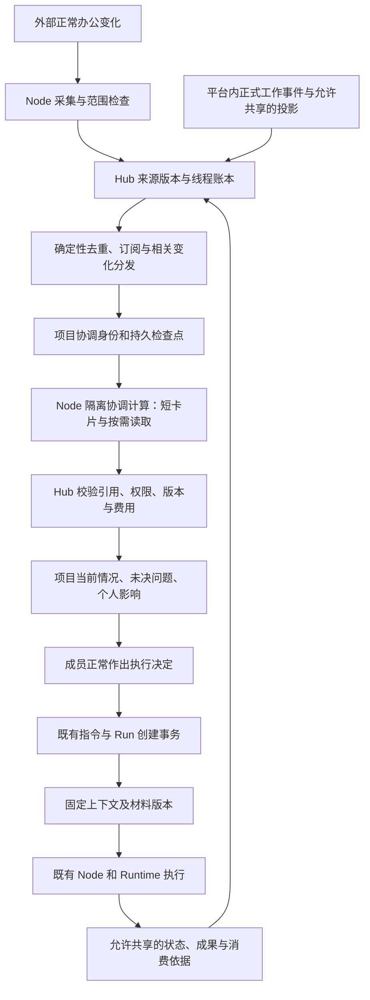

# dsh-superagent-prototype 与 WhalePod：复用分析及开发取舍

> 研读日期：2026-11-01（Asia/Shanghai）。上游固定提交 `6337fc823ce20251c8de8085948165c81aaa701e`；WhalePod 本地 closeout 分支 `a2c1244`（未推送），已核对远端主线 `e5bf4680fcb34b226ab941a1552136d021ec6060`。本轮只研读、运行隔离探针和修订文档，没有迁入业务代码、安装上游依赖或升级 DSH。

## 1 结论与产品方向

建议采用上游的**持续协调身份、线程订阅、按需读取上下文和独立执行器**，保留 WhalePod 的团队权限、PostgreSQL 权威状态、Node 隔离、明确指令、审批和成果依据。采用方式是选择性迁用源码与行为契约，再按现有事务和运行协议接线；不把整个 bundle 装进 Hub。

这次最有价值的修正，是把下一阶段的主角从“整理资料的后台流程”改为“持续跟进项目的协调角色”。它记住哪些问题尚未解决、谁的工作采用了哪些依据、下一步在等谁；消息和资料变化到来时，只处理相关变化，把必要上下文送到需要它的人和 Agent。成员照常讨论、修改资料、发起执行和验收成果，不另填协调台账。

上游已给出这套机制的可读实现，但适用对象是一个 GitHub 仓库中的编码工作，办公资料版本、多人权限和真人效率仍需 WhalePod 补齐。README 也明确说明：公开原型与内部版本、文章设计并不完全一致，部分文章方向尚未实现。[U1]

据此修订的[下一阶段计划](./2026-10-30-project-context-coordination-plan.md)先交付一条薄链：**正常工作事件 → 项目协调角色更新理解 → 找到受影响工作 → 相关成员处理 → 新 Run 采用新版依据**。真实办公平台接入同时推进；未获得租户时可以验证内部协调机制，但不能宣布办公闭环完成。

## 2 基线、范围与验证方法

| 项目 | 核对结果 |
|---|---|
| 上游仓库 | `deepseek-ai/dsh-superagent-prototype`，固定提交于 2026-10-31 12:05:39 UTC；MIT；包 `dsh-superagent@0.1.0` 标为 private |
| 上游运行依赖 | DSH `^0.2.1-alpha.2`，开发依赖固定 `0.2.1-alpha.2`；Cordis `4.0.5-alpha.1`；React `18.3.1` [U2] |
| WhalePod 运行依赖 | [catalog](../../pnpm-workspace.yaml) 与 [DSH 锁](../../dsh.lock.json) 固定 DSH `0.1.0-rc.8`、Cordis `4.0.1`；Web 为 React 19 |
| 本地与主线 | GitHub compare 显示历史各有一条提交，差异文件仅计划和来源验收两份 Markdown；下载主线两文件逐字比较与本地一致，产品源码无差异。未切分支或合并 |
| 已读范围 | 上游领域核心、Policy、SQLite Store、Effects/Session 交付、Assessor 与资源读取、DSH Executor、飞书归一化/事件/补拉、面板结构、部署说明；WhalePod 对应来源、指令、Run、执行上下文、Runtime/Node 边界与 ADR |
| 本轮动态验证 | 上游 `core-engine.spec.ts` 113 项、`stage.spec.ts` 31 项通过；另加四条隔离兼容性探针通过。使用现有 Node 24.12.0、Vitest 4.1.10、Zod 4.4.3，无新安装 |
| 未执行 | 上游整包构建与完整测试、真实 DSH 0.2.1 会话、飞书租户、云文档/表格、真实模型和真人效率试验；这些不包含在 148 条通过项中 |

原型测试声明 Vitest 4.1.8，本轮使用现有 4.1.10；测试结果只用于确认隔离核心行为。WhalePod 既有验收结果引用原验收文档，本轮没有重跑那些生产链路。

## 3 文章中的机制，在公开原型里到了哪一步

| 机制 | 源码中实际存在的部分 | 对 WhalePod 的意义 |
|---|---|---|
| 长期协调者与独立 Worker | 一个 main Session 接收候选、状态通知，按 Ticket 维护 Worker Session；见 `app/runtime.ts`、`app/sessions.ts`、`executor/dsh.ts` [U3][U4] | 值得采用逻辑结构。不能把所有成员私有 Session 汇入全局协调者，也不要求模型全天运行 |
| 快速规则与语义判断分层 | SourceScope 决定监听范围，Policy gate 判断工作准入，Assessor 异步判断，Engine 再检查当前策略；见 `core/ports.ts`、`policy.ts`、`app/assessment.ts` [U5][U6] | 可以把重复、无关与已订阅事件尽量留在确定性路径；模型输出不能授予权限 |
| 线程订阅和直接分发 | 一个 Thread 可以关联多份 Ticket；区分自己工作的线程与只供参考的线程；后续消息按订阅分发 [U7][U8] | 这是比“每条消息再总结一次”更重要的复用点。WhalePod 首轮将自动分发限定为只读上下文和影响通知 |
| 短内容内联，长内容按引用读 | `app/cards.ts` 给预览、长度及资源引用；`app/resources.ts` 分页读取；`app/assessment.ts` 按候选建立有界窗口、父消息和后续游标 [U6][U9] | 可采用相同接口风格，读取对象换成已授权的来源版本和团队投影；每次读取重新判权 |
| 异步工具与及时接收消息 | Worker 的 shell/job 等待有界；会话交付区分 queue、steer、inject；实际使用新 DSH inbox 和 persistence API [U10][U11] | 调度思想可用，执行器代码需要版本与协议改造；不能把 context 注入伪装成人类追问 |
| 低打扰协作 | Ticket 有 working、idle、等待人的不同原因；面板突出待答复、待审阅、阻塞与交付失败 [U12] | 项目概览与个人待办应解释“在等什么、为何找我”，比任意完成百分比更合适 |
| 飞书消息来源 | `lark-cli event consume im.message.receive_v1 --as bot`，配合群历史与订阅线程补拉；不是开箱即用的飞书 SDK 连接器 [U13] | 可借用消息解析和补拉组织；租户权限、CLI 生命周期和只读能力仍要实测 |
| 云文档、表格的持续版本监听 | 当前飞书 Source 面向消息、线程、消息图片；没有本计划所需的文档/表格修订链 [U13][U14] | 需要另做资料适配，不能由“已经接了飞书”推导为已支持办公资料 |
| 推测执行、完整云端计算/状态/执行环境分离、语义 Watchdog | 本次在源码和部署资料中未发现可对应整套机制的实现。部署脚本及建议的定时检查提供进程/组件健康恢复 [U15] | 不列为已实现的直接复用项；首轮不以此作为协调价值的前置条件 |

尤其要区分“能查看 Worker transcript”与“团队已获得可共享工作上下文”。上游资源读取可展开 Session 消息；`transcriptEntry` 虽省略 reasoning，仍不是 WhalePod 的受众过滤和私有 Workspace 边界。应使用正式成果、任务事件和已允许共享的投影替换，而非把过滤 reasoning 当作完成隐私隔离。[U16]

## 4 哪些可以直接复用

这里的“直接”指保留原有职责和业务语义；新增协议字段、调用接线与测试仍属于各切片交付。上游代码目前尚未迁入仓库。

### 4.1 WhalePod 的现有基础设施

| 可保留的实现 | 源码入口 | 在新链路中的职责 |
|---|---|---|
| Team、Project、Task 与成员权限 | [CONTEXT](../../CONTEXT.md)、[Hub 模块](../../apps/hub/src/modules) | 项目归属、责任人与执行权威，不复制一套“上游成员” |
| 来源绑定与生命周期 | [source/commands.ts](../../apps/hub/src/modules/source/commands.ts)、[reconciler.ts](../../apps/hub/src/modules/source/reconciler.ts)、[source 协议](../../packages/protocol/src/source.ts) | 整 Team 共享、本人 Node、应用采集租约、授权代次、暂停/恢复/撤销和权限重验 |
| 幂等命令、事务事件和派发 | [Run 指令](../../apps/hub/src/modules/run/instruction.ts)、[followup](../../apps/hub/src/modules/run/followup.ts)、[outbox](../../apps/hub/src/modules/run/outbox-worker.ts) | 用户确认后的执行仍走既有鉴权、Task 锁和 Outbox；协调层只提出请求 |
| 固定版本执行依据 | [execution-context.ts](../../apps/hub/src/modules/run/execution-context.ts)、[ADR-0016](../adr/0016-run-artifact-input-snapshot.md)、[ADR-0020](../adr/0020-execution-context-consumes-handoff.md) | 在创建事务里固定本次实际材料、交接与上下文；重放不换依据 |
| Node 凭据与独立进程 | [SecretStore](../../apps/node/src/secret/store.ts)、[RuntimeDriver](../../apps/node/src/runtime-driver.ts)、[supervisor](../../apps/node/src/supervisor/runtime-supervisor.ts) | 来源凭据本地保管，执行环境隔离；新增协调任务需新增装配和用途边界，不能直接占用业务 Run |
| Runtime 的指令、审批和消费路径 | [SessionOwner](../../packages/runtime-dsh/src/session-owner.ts)、[bridge](../../packages/runtime-dsh/src/bridge.ts)、[RunManager](../../apps/node/src/run/run-manager.ts) | 继续承担业务 Agent 执行；不被上游 DshExecutor 替换 |
| 成果发布、交接与审阅 | [交付闭环验收](./delivery-loop-acceptance.md)、[依据验收](./delivery-basis-acceptance.md) | 成果与人工确认提供可靠项目事件；模型报告不能直接更改完成状态 |

PC-02a 已交付的是协议、数据模型和 Hub 生命周期，详情见[来源验收](./project-source-lifecycle-acceptance.md)。真实飞书 Node 适配器、来源 Web 页、正文版本和派生失效尚未交付。`autoExtraction=true` 当前仍被拒绝，不能借新增协调者绕开这个开关。

### 4.2 上游可独立迁用的源码与测试

- `core/ids.ts` 的稳定摘要、`infra/text.ts` 的文本长度与分页辅助等纯函数，可以在精确固定版本、保留 MIT 声明后选择性迁用。身份参数必须加入 WhalePod 的 Team/Project/Source 作用域，不能直接沿用跨租户短键。
- `core/memory.ts` 和 `tests/core-engine.spec.ts` 适合用作协调引擎的隔离试验与行为参照；其中自动恢复、消息权限等断言要改成 WhalePod 规则，不能把上游全绿直接当作我们的验收。
- `core/stage.ts` 的“等待人/工作中/空闲/结束”优先判定可用于协调状态设计；映射函数须按 Task、Run、Approval、审阅事实重写，不另建竞争性任务状态。
- `app/cards.ts` 的短卡片、长度、引用与后续分页契约可迁用结构；涉及目录、transcript 和可见字段的部分必须替换。

上游 `src/core/` 的运行依赖与 DSH 分离，这一点已由独立运行 144 项测试验证。但发布包没有 `./core` 入口；根入口同时导入整个 Runtime，所以不能在 Hub 直接 `import` 根包来获得“纯核心”。生产迁用应单独抽取已审查文件，登记提交、文件清单、修改点与许可证，而不是把上游 package.json 的宽松 DSH 范围带入锁文件。[U2][U3][U5]

## 5 必须改造的部分与原因

### 5.1 核心的持久化端口不是异步数据库接口

上游 Repositories 的所有读写都是同步操作，`atomic(work)` 同步完成；Engine 在其中同时更新聚合与排队副作用。Store 用 `node:sqlite` 的 `DatabaseSync` 与保存点实现。WhalePod 使用异步 PostgreSQL 事务，不能给同步接口塞入 Promise 或靠类型转换跨过这个差异。[U5][U17]

建议保留领域拆分和行为用例，把协调状态变更迁写为 Hub 的异步事务命令；在同一事务中锁定项目协调状态、校验来源代次、追加决策与订阅变化、写 Outbox。模型判定发生在事务外，提交时复核输入水位和策略版本。受影响评估失效后重排，不长时间持有数据库锁等待模型。

不引入第二份 SQLite 作为团队状态权威，也不为原样使用整个 Engine 额外建设同步镜像数据库。Node 可保留既有本地 spool/缓存职责。若兼容性试验表明抽取的纯状态转换足以复用，后续切片再采用；目前不能承诺“只写一个 Store 适配器”。

### 5.2 Ticket 不能直接等于 Run

上游 Ticket 是长期工单，Assignment 是尝试，Worker Session 按 Ticket 持续存在。Ticket 结束后，自己线程上的人类消息可在旧 Mandate 仍有效时立即重开 Ticket、建立新 Assignment；无需新准入 Decision。只供参考的线程不会自动唤醒已结束 Ticket，人工停止的 Ticket 也不会被这样恢复。[U7][U8]

WhalePod 的 [Run 状态表](../../packages/domain/src/run.ts) 禁止终态复活，[ADR-0013](../adr/0013-explicit-execution-intent.md) 要求明确执行意图。建议映射如下：

| 上游对象 | WhalePod 中的候选对应 | 处理方式 |
|---|---|---|
| Source / Trigger | ProjectSource / 来源事件与不可变版本 | 增加授权代次、版本、当前读取权限及缺口；先判权后留正文 |
| Thread | 一个项目内的来源线程或工作线索 | 可服务多个 Task，不以“一线程一任务”建唯一约束；不能跨过 ADR-0024 的绑定项目边界 |
| Ticket | Task 关联的持续协调记录，或尚未建 Task 的工作建议 | 先复用现有 Task 身份；无实际责任和执行的变化不强制建任务 |
| Assignment | 某次已授权业务 Run 的关联记录 | 一次新的执行必须创建新 Run；旧 Run 终态、输入和成果依据保持不变 |
| Mandate | 独立的执行授权议题 | 首轮沿用现有明确指令与授权人；来源绑定及订阅不构成 Mandate |
| Report / Question | 执行投影、成果、待澄清问题 | 保留报告与正式业务事实之分；完成仍由现有业务路径决定 |

原型的恢复行为本身符合它的长期工单设计；它与 WhalePod 的授权和运行协议不同，不能据此称为 WhalePod 的漏洞，也不能直接照搬。

### 5.3 来源可读、上下文相关、允许执行是三个独立判断

上游并非只靠提示词授权：Policy 有发送者名单、显式/推断准入、模式和规则版本，Engine 会重验 Mandate。[U5][U18] 但原型没有 WhalePod 的 Team 成员、任务责任人、指令权、Node 所有权和来源授权代次这些完整对象。

WhalePod 的自动订阅首轮只产生上下文引用、影响标记、问题和工作草案。讨论里的“帮我改一下”、@Agent、平台账号显示名或文本里的“老板已同意”不能直接变成 `run.followup`、取消、审批或新 Run。后续若要允许团队预先授权某类自动执行，必须另写有范围、期限、预算和撤销规则的 ADR；本阶段不默认开放。

上游 `Intake` 对 Scope 拒收事件仍保存整条 Trigger。WhalePod 必须在正文进入团队存储和模型输入前执行来源授权、范围与租约校验；越界只留允许的最小拒绝审计，不复用该正文保留行为。[U7]

### 5.4 直接分发不能绕过固定执行依据

上游 Executor 会把订阅消息送到已有 Worker Session，并记录 delivered/read 等阶段。WhalePod 应采用这种可观测交付思想，但增加明确区分：

1. 项目协调者持续接收授权上下文，更新项目理解和未决问题。
2. 活跃业务 Run 首轮只获得“依据已变化”的产品提示；不自动注入成追问，不自动停止或改变输入。
3. 成员沿原执行入口明确续跑时，新 Run 装配新版项目参考快照；已有 Artifact 输入按 ADR-0016 继承，换版仍需明确选择。主动 followup 的权限、排队和撤销由原链路裁决。

如果以后需要给活跃 Worker 注入只读参考，应设计独立的 context 通道、接收策略与消费回执，先修订 ADR，不能借用“人类指令”帧实现。这是下一阶段的扩展条件，不是首轮新增承诺。[U10]

### 5.5 飞书适配要补版本、撤回、资料和 Node 归属

可采用 live + 有界历史补拉 + 订阅线程巡检的结构，但当前实现存在这些差距：[U13][U14]

- Trigger ID 只由 message_id 得到；同一消息编辑正文仍产生同 ID，Engine 先去重，旧正文保留。必须拆开消息身份、修订身份、事件幂等身份。
- 历史扫描按 create_time 推进，删除项被跳过；上下文读取能表示 deleted，不等于已有撤回事件、派生摘要失效与正文清除链。早期消息后来被编辑，也不能只靠新消息游标发现。
- 运行环境依赖已配置的机器人 CLI，监听与工作执行可能同时有发送能力。首轮来源采集器须只读，不继承消息发送、GitHub 写入和全局 Shell 环境。
- 未实现云文档/表格修订监听；至少另做一种资料适配，并验证可读范围、稳定版本或摘要、修改后的重读与撤权。
- 上游没有 WhalePod 的来源采集租约、owner Node、generation fencing 和整 Team 共享确认；这些保留在已有协议外层。

PC-01 用真实租户比较 CLI 与官方 SDK 两条入口的普通群消息、线程、资料读取、撤销、凭据隔离和安装成本，再确定实现。现有计划中“建议 SDK 长连接”降为候选方案，不能以原型的 CLI 已存在替代实测。

### 5.6 DSH Executor、工具权限和 UI 均需重新接线

上游调用 `sessionController`、`sessionPersistence`、`workspaceRegistry`、`permissionPresets`、`subprocess` 等新服务，为 Ticket 持续复用 `worker-<ticketId>`。它还设置 `danger-full-access`，通过 preset、工具集合和命令环境施加其他限制；Router preset 仍包含 shell。此装配不是 WhalePod 当前的 Run 独立进程与审批模型。[U3][U4][U11]

`infra/environment.ts` 会修改进程级环境；上游部署说明要求使用独立 DSH profile。整包加载到 Hub 既不满足依赖版本，也违反“Hub 不加载 DSH”和凭据/进程隔离规则。[U19][U15]

首轮保留现有 Runtime Bridge。协调身份先持久化在 Hub，每次唤醒在 Node 上运行有界、受限的协调计算，复用驱动和本机模型配置。长期 DSH Session 是否必要、rc.8 能否实际禁用所有业务工具，由兼容性试验决定；不能把上下文检查点误称为已有新 Session API。

上游面板依赖 DSH 插槽、HTTP 状态模型、React 18 和自己的 Ticket 状态，不能整体嵌入 WhalePod Web。复用“待人处理”“为什么收到这条变化”“点开出处”的交互，把状态接到现有 Project/Task/个人待办。

## 6 推荐的接入形态



### 6.1 最小新增对象

建议先落四组对象，具体名称与字段由 ADR 固化，本文不直接定义新协议：

1. **来源版本与事件**：身份、修订、授权代次、范围、水位、删除/不可读及来源位置。沿用 ProjectSource，不另建来源授权系统。
2. **线程、订阅与工作关联**：Thread ↔ Task/Run 多对多；区分只读参考、真实消费和模型推断。首次可从 Run 的固定输入和项目归属建立明确关联，模型提出的关联保持可纠正。
3. **项目协调检查点与评估记录**：已处理水位、活动工作引用、未决问题、近期判断、引用、模型/规则版本和额度。崩溃后可从权威记录重建；模型记忆不成为第二份事实库。
4. **Run 上下文快照与消费记录**：本次选入条目、材料字节摘要、来源版本、权限和选择规则。创建幂等、派发再判权、实际消费可验证。

目标/事实/推断/决定等分类仍需要，但不先建设任意关系图谱、全量向量化和通用知识库。先用少量可追溯引用支持真实闭环，再决定是否需要独立的 ContextEntry/Relation 全模型。

### 6.2 首轮运行边界

- 每 Project 一个逻辑协调身份，处理 Team 可共享且属于该 Project 的内容；不跨项目扫描，不读取个人原始 Session 或 Workspace。
- 长期身份不等于常驻推理。确定性变化先入账，相关变化合并唤醒，空闲不轮询模型；检查点与读面显示各来源水位和缺口。
- 首次启用明确模型 Node、操作者、费用归属、日额度、并发和停机行为。共享常驻 Node 不绕过 ADR-0024 的“采集 Node 属于绑定者”；采集与协调计算可以分属已授权 Node。
- 上下文资料中的指令不能扩大工具或资料权限。受限计算只回传结构化判断；提交前再次检查来源代次、可见范围、输入水位与人工纠正。
- 自动业务执行、对办公群发送消息、活跃 Run 自动接收参考、跨平台代人发言、语义 Watchdog 和推测执行均不包含在首轮交付。

## 7 已运行的验证与可复跑证据

### 7.1 四条兼容性探针

| 探针 | 操作与已观察结果 | 开发约束 |
|---|---|---|
| P1 消息修改 | 用相同 Feishu message_id 先输入预算 120000，再输入 80000；第二条返回 duplicate，仓储仍为 120000 | 修订身份必须独立；重读/编辑不能被事件去重吞掉 |
| P2 来源过滤 | Scope 返回不监听；receive 返回 filtered，但仓储仍能读到原正文 | 授权校验在持久化正文前完成，不直接采用原保留语义 |
| P3 工单恢复 | Alice 创建并结束 Ticket；fresh gate 会拒绝的 Guest 在原线程发言；旧 Mandate 仍有效，Ticket 重开且 Assignment 数从 1 变 2 | 不照搬到 Run/执行授权；这不是对上游真实平台权限的攻击测试 |
| P4 只读订阅 | 两个 Ticket 关联同一线程，后续消息分发给两者，并标记 context-only 订阅；该订阅者结束后不因下一条消息恢复 | M:N 与 context-only 分类值得复用；WhalePod 进一步限制自动上下文的执行能力 |

这四项通过说明“原型确实有上述行为”，并非说明这些行为已经满足 WhalePod。P3 的 Policy 和 Executor 是隔离假实现，用于观察核心恢复契约。

本地证据位于 `artifacts/evidence/superagent-analysis/6337fc8/`：

- `review-results.json`：源码摘要、固定基线、逐项测试结果、工具版本与覆盖边界。
- `contract-probes.spec.ts`：四条完整探针。
- `README.md`：尝试记录与复跑指引。首次探针因隔离目录尚未链接已有 Zod，零测试执行；补链接后第二次 4/4 通过，首次失败记录仍保留。

证据包依仓库规则不进 Git；本文保存关键断言与来源，便于重新生成。它不是生产装配验收，不登记为 PC-00 或 PC-09 已完成。

### 7.2 复跑方式

准备固定提交的干净源码目录，以 `UPSTREAM_REVIEW` 指向它，以 `WHALEPOD_REPO` 指向已有依赖的本仓库，以 `REVIEW_EVIDENCE` 指向本地证据包。仅在隔离源码目录链接现有 `vitest` 与 `packages/protocol/node_modules/zod`，不要安装 bundle。将证据包探针复制到该源码的 `tests/whalepod-review.spec.ts`；上游原有文件保持不变。

```sh
"$WHALEPOD_REPO/node_modules/.bin/vitest" run \
  --root "$UPSTREAM_REVIEW" --config "$UPSTREAM_REVIEW/vitest.config.ts" \
  tests/core-engine.spec.ts tests/stage.spec.ts tests/whalepod-review.spec.ts
```

应分别得到 113、31、4 项通过。若包不存在或测试零项执行，应报告失败，不能沿用上次结果。迁写到 Hub 后，还需生产 HTTP/WS、真实 PostgreSQL、Node/Runtime 装配及负控，不能复用这里的内存测试作为放行证据。

## 8 对下一阶段计划的具体修订

| 原计划倾向 | 本次修订 |
|---|---|
| 外部采集、提取、概览全部完成后再验证协调价值 | 新增 PC-00：用现有内部事件与确定性回放，尽早验证“协调角色记住工作、订阅变化、关联影响、新 Run 消费” |
| ContextEntry/Relation 通用模型先行 | 先落来源修订、线程/订阅、协调检查点和 Run 消费引用；复杂图谱随真实缺口再加 |
| PC-04 以逐资料后台提取为核心 | 改为项目持续协调；包括问题保持、上下文选择、变化关联、影子工作建议和恢复 |
| 默认以 SDK 实现飞书 | CLI/SDK 同为 PC-01 候选；对接现有租约和撤权；云资料独立切片 |
| 直接按上游 Session/Worker 拼接 | 先固定对象映射、权限、PostgreSQL 事务和受限协调计算；业务 Worker 保持现有装配 |
| 通知和概览在末段建设 | 每条薄链同时交薄概览与个人影响，双成员早用；真实文档接通后才完成办公里程碑 |
| 背景“提取任务”ADR | #452 扩展为持续协调生命周期、能力限制、唤醒、恢复与成本；#451/#453 同步覆盖线程关联和引用/执行边界 |

本次修订不更改 ADR-0024 的已采纳结论，也不静默推翻 ADR-0010/0013/0016。#451–#453 当前是 GitHub 上的 Proposed 议题，仓库尚无对应已采纳 ADR 文件；要先更新议题并形成可评审 ADR，不能只在实现中更换含义。#450 Issue 仍打开且标题残留 Proposed，但仓库 ADR-0024 已采纳，状态以权威 ADR 为准。

未解决的外部条件仍是 #448 的真实租户和应用授权。可独立推进 PC-00 和 ADR 研讨；不能用上游 mock、内部事件或手工转发把 #448 标为完成。

## 9 源码与权威依据

上游链接全部固定到本次研读提交；方括号编号对应正文事实。WhalePod 以仓库当前权威文件为准。

- [U1 README](https://github.com/deepseek-ai/dsh-superagent-prototype/blob/6337fc823ce20251c8de8085948165c81aaa701e/README.md)：原型定位与公开范围。
- [U2 package.json](https://github.com/deepseek-ai/dsh-superagent-prototype/blob/6337fc823ce20251c8de8085948165c81aaa701e/package.json)：版本、依赖、exports 与许可证；[LICENSE](https://github.com/deepseek-ai/dsh-superagent-prototype/blob/6337fc823ce20251c8de8085948165c81aaa701e/LICENSE)。
- [U3 index.ts](https://github.com/deepseek-ai/dsh-superagent-prototype/blob/6337fc823ce20251c8de8085948165c81aaa701e/src/index.ts) 与 [Runtime](https://github.com/deepseek-ai/dsh-superagent-prototype/blob/6337fc823ce20251c8de8085948165c81aaa701e/src/app/runtime.ts)：插件注入及协调装配。
- [U4 DshExecutor](https://github.com/deepseek-ai/dsh-superagent-prototype/blob/6337fc823ce20251c8de8085948165c81aaa701e/src/executor/dsh.ts)：Ticket Worker、目录、重试与恢复。
- [U5 核心端口](https://github.com/deepseek-ai/dsh-superagent-prototype/blob/6337fc823ce20251c8de8085948165c81aaa701e/src/core/ports.ts) 与 [Engine](https://github.com/deepseek-ai/dsh-superagent-prototype/blob/6337fc823ce20251c8de8085948165c81aaa701e/src/core/engine.ts)：同步仓储、准入、评估与执行端口。
- [U6 MasterAssessor](https://github.com/deepseek-ai/dsh-superagent-prototype/blob/6337fc823ce20251c8de8085948165c81aaa701e/src/app/assessment.ts)：有界上下文、评估、读取及决策提交。
- [U7 Intake](https://github.com/deepseek-ai/dsh-superagent-prototype/blob/6337fc823ce20251c8de8085948165c81aaa701e/src/core/intake.ts)：去重、过滤保留与订阅分发。
- [U8 Tickets](https://github.com/deepseek-ai/dsh-superagent-prototype/blob/6337fc823ce20251c8de8085948165c81aaa701e/src/core/tickets.ts)：wake、Mandate 重验与只读参考线程。
- [U9 卡片](https://github.com/deepseek-ai/dsh-superagent-prototype/blob/6337fc823ce20251c8de8085948165c81aaa701e/src/app/cards.ts) 与 [资源读取](https://github.com/deepseek-ai/dsh-superagent-prototype/blob/6337fc823ce20251c8de8085948165c81aaa701e/src/app/resources.ts)：短预览、引用与分页。
- [U10 AgentDelivery](https://github.com/deepseek-ai/dsh-superagent-prototype/blob/6337fc823ce20251c8de8085948165c81aaa701e/src/app/delivery.ts)：消息身份、inbox、恢复后的交付去重。
- [U11 Sessions](https://github.com/deepseek-ai/dsh-superagent-prototype/blob/6337fc823ce20251c8de8085948165c81aaa701e/src/app/sessions.ts) 与 [bundle preset](https://github.com/deepseek-ai/dsh-superagent-prototype/blob/6337fc823ce20251c8de8085948165c81aaa701e/cordis.patch.yml)：新 DSH API、工具集合、权限与等待上限。
- [U12 Stage](https://github.com/deepseek-ai/dsh-superagent-prototype/blob/6337fc823ce20251c8de8085948165c81aaa701e/src/core/stage.ts)、[面板说明](https://github.com/deepseek-ai/dsh-superagent-prototype/blob/6337fc823ce20251c8de8085948165c81aaa701e/docs/005-panel.md)：需要人处理的阶段。
- [U13 飞书循环](https://github.com/deepseek-ai/dsh-superagent-prototype/blob/6337fc823ce20251c8de8085948165c81aaa701e/src/sources/feishu-loops.ts)、[Source](https://github.com/deepseek-ai/dsh-superagent-prototype/blob/6337fc823ce20251c8de8085948165c81aaa701e/src/sources/feishu.ts)：CLI 事件与补拉。
- [U14 飞书 Trigger](https://github.com/deepseek-ai/dsh-superagent-prototype/blob/6337fc823ce20251c8de8085948165c81aaa701e/src/sources/feishu-trigger.ts) 与 [线程读取](https://github.com/deepseek-ai/dsh-superagent-prototype/blob/6337fc823ce20251c8de8085948165c81aaa701e/src/sources/feishu-read.ts)：身份、时间、正文与删除表示。
- [U15 部署说明](https://github.com/deepseek-ai/dsh-superagent-prototype/blob/6337fc823ce20251c8de8085948165c81aaa701e/docs/006-deployment.md) 与 [进程管理脚本](https://github.com/deepseek-ai/dsh-superagent-prototype/blob/6337fc823ce20251c8de8085948165c81aaa701e/scripts/dsh-superagent)：独立 profile 与健康恢复。
- [U16 Transcript 投影](https://github.com/deepseek-ai/dsh-superagent-prototype/blob/6337fc823ce20251c8de8085948165c81aaa701e/src/app/context.ts)：省略 reasoning 的范围。
- [U17 Store](https://github.com/deepseek-ai/dsh-superagent-prototype/blob/6337fc823ce20251c8de8085948165c81aaa701e/src/app/store.ts)：同步 SQLite 事务。
- [U18 Policy](https://github.com/deepseek-ai/dsh-superagent-prototype/blob/6337fc823ce20251c8de8085948165c81aaa701e/src/policy.ts)：代码化准入、策略版本与 Mandate 重验。
- [U19 Environment](https://github.com/deepseek-ai/dsh-superagent-prototype/blob/6337fc823ce20251c8de8085948165c81aaa701e/src/infra/environment.ts)：进程环境与 CLI shim。
- [WhalePod ADR-0001](../adr/0001-dsh-is-runtime-not-product-authority.md)、[0003](../adr/0003-private-workspace-team-projection.md)、[0004](../adr/0004-runtime-process-isolation.md)、[0010](../adr/0010-discussion-execution-separation.md)、[0013](../adr/0013-explicit-execution-intent.md)、[0016](../adr/0016-run-artifact-input-snapshot.md)、[0024](../adr/0024-source-sharing-and-revocation.md)：团队权威、私有边界、运行隔离、明确执行与来源撤销。
