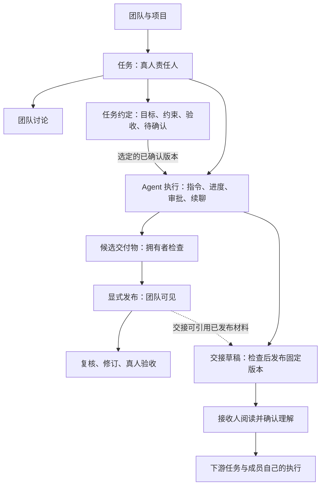
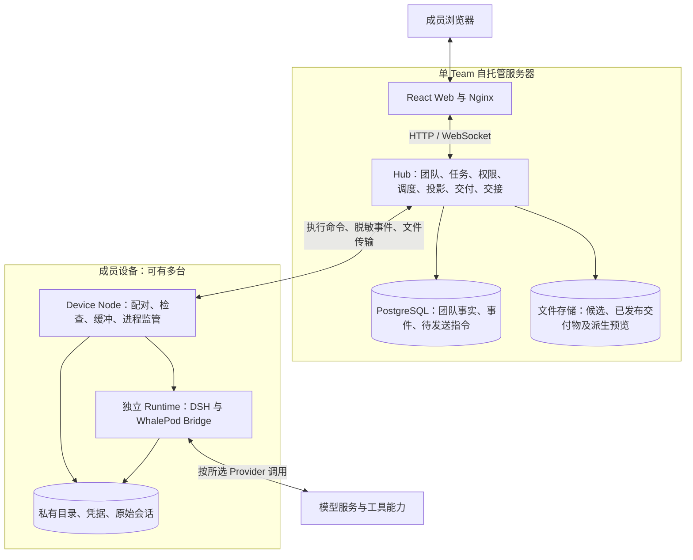

# WhalePod 项目背景与产品方向讨论简报

> 快照日期：2026-10-26（Asia/Shanghai）。
> 用途：交给未参与过本项目、也无法读取仓库的 Agent 或产品顾问，独立研讨用户痛点、产品定位和下一阶段方向。
> 本文已包含开始讨论所需的背景；末尾链接仅供可选追溯，不要求接收者打开。
> 讨论范围：产品研讨。本文不授权改代码、提交、合并、发布或联系其他人。

## 1. 本次希望解决的核心问题

WhalePod 是面向 3–10 人小团队的自托管 Agent 协作产品。成员围绕共同任务使用 Agent，在各自可控的设备与私有目录中执行，并把需要共享的进展、成果和交接内容带回团队。

目前最重要的产品问题是：

**相对于一个熟练使用“即时通讯＋个人 Agent＋文档／仓库”的团队，WhalePod 能否让跨成员的理解、验证、接手和继续工作更省事，而且收益足以覆盖部署、学习和新增操作成本？**

项目已具备可运行的 Alpha，正在增加交付物审阅能力，但没有真实团队的对照结果证明上述命题。

我们需要一份能被验证、也允许被推翻的方向建议。请独立判断首批用户、关键场景、产品形态和必要功能；不要求维护现有方案，也不以已经投入的开发工作作为继续投入的理由。

## 2. 项目定位、目标用户与尚未确定的市场

### 2.1 当前定位

当前正式定位是“面向 3–10 人小团队的 DSH 多人协作发行版”：WhalePod 管理团队事实与协作体验，DSH 提供 Agent Runtime 和插件能力。

这里的 DSH 可以理解为底层 Agent 执行引擎，负责模型调用、工具、会话和插件。WhalePod 在它之外建立团队、任务、权限、交付与交接关系。接收者不需要了解 DSH 的实现细节即可讨论产品。

这一定义主要描述系统形态。我们正在检验的用户价值表达是：

> 一个人的 Agent 工作，能够被另一个人理解、验证、接管和继续，同时保留成员对私有环境与执行权限的控制。

这是一项产品假设，尚未得到真实团队验证。

### 2.2 候选早期用户

目前较容易开展试用的人群是已经使用个人 Agent、具有共同任务、能接受 Alpha 和一定技术配置成本的小团队。技术或产品团队是候选，不代表已确定目标市场。

候选工作包括：

- 资料整理者把来源、结论和疑问交给报告撰写者。
- 撰稿者把初稿交给同事审阅，再由自己的 Agent 根据意见修订。
- 一位开发者把接口实现与验证结果交给另一位成员继续集成。
- 成员接手一项已由他人和其 Agent 推进过的工作。

前期讨论重点包含“团队写作”，后来收敛到跨成员交接和交付物审阅。**尚未确定写作、软件研发或其他工作哪一个最值得先做。** 请不要把示例当成真实访谈结果，也不要把已选定细分市场作为前提。

### 2.3 仍然未知

没有足够资料回答以下问题：目标用户最集中的行业与岗位、交接频率、单次损失、现有工具的缺口、可接受的部署成本、持续使用意愿、付费主体与付费意愿。

## 3. 必须认真对待的替代方案

比较对象是团队实际熟悉的工具组合：

**即时通讯＋每个人自己的 Agent＋Word／共享文档／GitHub 等团队已有工具。**

具体产品随团队变化。它们可能已经使用：交接模板、AI 总结、文件版本、文档批注、修改建议、共享链接，以及 Agent 对文件和代码仓库的读取能力。

请允许对照组使用这些正常能力。不能假设聊天记录无法搜索、个人 Agent 无法读取批注，或所有交接都必须手工从零整理。

WhalePod 可能提供的增量是：将要求、材料、责任与反馈绑定到明确对象和版本，减少反复组织上下文，并确保选定内容实际进入执行。这种增量必须与原有工具组合直接比较。

WhalePod 也增加成本：团队服务器、设备配对、目录登记、模型配置、常驻程序、版本维护、概念学习，以及检查和确认操作。已有模板或一次总结就能解决的问题，未必值得引入独立平台。

## 4. 核心对象和产品规则

| 对象 | 含义 | 讨论时需要避免的误解 |
|---|---|---|
| Team | 一个部署实例中的成员与资产归属根 | 当前不是多租户企业组织平台 |
| Project | 围绕长期目标组织任务、讨论和成果 | 不等于共享文件夹或执行环境 |
| Task | 一名真人负责推进的工作单元，可包含多次执行 | 不等于一段聊天或一次模型调用 |
| Assignment | 任务受派关系；分给真人时需接受或拒绝 | 分配任务不代表已开始执行 |
| Agent | 团队共享的长期 AI 角色，具有名称与配置版本 | 共享角色不等于共享完整会话记忆 |
| Profile Revision | 某次执行使用的 persona、模型路由、Skill 与插件配置快照 | 后续修改角色配置不会改写历史执行 |
| Device / Node | 成员控制的设备及其常驻执行程序 | 不是共享 Agent 身份 |
| Workspace | 成员在设备上登记的私有执行目录 | 项目与其他成员不能因此浏览本机目录 |
| Run | 任务的一次执行，绑定责任人、Agent、环境与配置快照 | Run 完成不等于 Task 已验收完成 |
| Approval | 对具体工具操作的一次性审批 | 不等于任务验收或永久授权 |
| Artifact | 某次执行产生、经检查发布的可寻址交付物 | 不等于所有本地文件或普通聊天附件 |
| Handoff | 版本化交接内容、交付关系、接收理解与固定输入 | 不等于把对方的整个原始会话搬过来 |

补充规则：

- Task 即使受派给 Agent，也保留真人责任人。
- 同一 Task 当前只允许一个活跃 Run；不同任务可以分别执行。没有同一任务内的团队 Agent 自动并行分工与合稿能力。
- 活跃执行可接受追问；续跑创建新的执行记录并接续来源会话；重跑创建新记录、不继承原会话上下文。
- 团队讨论与执行指令有独立入口。发评论、批注、邀请和确认接收，不应隐式启动 Agent。
- 候选交付物仅拥有者可见；显式发布后团队可见。“已发布”不代表“已定稿”。
- 任务完成由真人按现有验收流程确认，Agent 不能自动关闭任务。
- 所有成员当前可见所有 Project，没有项目级私有访问控制；个别候选、私有投影与本机资源另有权限边界。

## 5. 当前产品架构与工作流程

### 5.1 产品组织方式

当前主要围绕任务组织工作，而非围绕一份多人实时编辑的文档。

图中的任务约定和交接按需启用，个人任务不必经过全部步骤。图中的“复核、修订”包含既有的整件交付物复核；针对逐条批注的完整修订体验仍在开发中，具体进度见第 6 节。

### 5.2 系统架构

如果阅读工具不支持 Mermaid，可按这条链理解：浏览器访问团队服务器；服务器把执行交给成员设备；设备启动独立 Agent 进程；经权限控制的进度和成果返回团队服务器。

Hub 管团队事实，Node 管成员执行现场，Runtime 管 Agent 执行。技术栈主要为 TypeScript、React、Fastify、PostgreSQL 和 DSH；当前采用模块化单体 Hub，不是微服务集群。

原始会话、凭据与设备绝对目录不上传 Hub。Hub 会保存有权限控制的候选、已发布文件和脱敏投影。团队成员看到的执行信息少于拥有者，不能假设任何同事都能读取完整 Agent 对话。模型请求按所选 Provider 处理，**“原始日志保留本地”不代表所有模型计算或数据处理都在本地完成。**

### 5.3 已有核心路径

1. 建立团队并邀请成员，创建项目、任务与 Agent。
2. 需要执行的成员准备 Node、私有目录和模型凭据；只参与讨论或审阅的人可以仅用浏览器。
3. 责任人接受任务，选择 Agent 与环境，发起执行。
4. 团队观察脱敏进度；需要时由有权成员审批或取消操作。
5. Agent 提交候选，拥有者检查后发布；可基于已发布文件发起另一次 Agent 复核。
6. 需要交接时，责任人检查交接草稿、发布不可变版本，并交付给同项目的下游任务。
7. 接收人读取指定版本、提出疑问、填写理解。确认理解、接受任务、开始执行是独立动作。
8. 下游执行固定所选交接正文、接收理解和材料；上游发布新版不会改写旧执行。接收方显式采用新版后才影响之后的执行。
9. 真人检查交付与复核结果，提交验收并确认任务完成。

当前没有完整的协作文档编辑器、实时共同改稿或自动同步全部工作目录的能力。网页附件上传仍冻结，这与 Agent 从成员目录产出并提交 Artifact 是两件事。

## 6. 当前进度快照：不要把开发完成等同于已经可用

本节依据 2026-10-26 对远端状态、本地代码和既有验收文档的核对。它不是线上部署现场审计，也没有在整理本文时重新运行全量测试。

| 能力 | 快照状态 | 可支持的判断与剩余边界 |
|---|---|---|
| 基础任务、执行、审批、发布、续聊、版本化交接 | 已发布 `v0.1.0-alpha.9`，发布时间 2026-10-23 | 发布记录包含生产装配浏览器链路 20/20 通过；模型出口主要为 DSH replay，不能据此认定真实模型质量或真人提效 |
| 交接待办、固定版本直达、向上游提问 | 已合入主线，PR #433 / Issue #428 | 有定向集成与页面判据；该切片未重跑生产装配 Q5，不包含材料在线预览 |
| 文本及整件批注、回复、审阅邀请、提交意见 | 开发中，PR #435 / Issue #429 未合入 | 前后端代码及定向验收记录已存在；远端最新检查为 `check` 成功、`integration` 失败，本文未确认具体失败原因 |
| 按选定批注组织 Agent 修订、关联新版、人工复核 | 本地后端已实现，Issue #430 尚未整体交付 | 有快照与 Hub 下发判据；前端入口、待处理反馈、待复核和版本比较未接通；未跑新的真实 Node→Runtime 审阅全链 Q5 |
| DOCX / XLSX / PPTX 转只读 PDF 预览 | 本地 Node / Hub 后台已实现，Issue #431 尚未整体交付 | 有真实样本转换烟测及接口判据；前端未接线。转换依赖部署机 LibreOffice，缺失或失败回退下载；版式质量没有完整评估 |
| PDF 页码／区域批注、图片区域批注 | 尚未实现 | 已有设计，不能当作现成能力 |
| 管理界面、状态和动效优化 | 已有多批合入主线 | 有界面验证；这些变化本身不能证明协作收益 |
| 真实团队对照与持续使用 | 未开展；记录仍为 `not_run` | 无可报告的团队提效、留存、付费或市场匹配结论 |

核对标识：远端 `main` 为 `118f4c5`（2026-10-24）；本地核对分支为 `feat/p1-431-office-preview`、提交 `d03c56d`。最近发布版本仍为 `v0.1.0-alpha.9`。具体用户实例实际运行什么版本，本文未核对。

本地后续分支包含尚未合入的工作。不能将“本地能读到实现”解释为“主线、发行版或用户实例已经具备”。同样，Issue 未关闭不能单独证明功能未实现，需结合上述代码、合入与验证边界判断。

## 7. 已知证据与不能声称的结论

### 7.1 已有证据

- 基础两成员交接已通过真 Hub、Node、Runtime 装配驱动，包含固定版本、材料摘要校验和上下文传递的机器判据。
- 发布工作流有静态、单元、数据库、Runtime 契约、故障、安全与浏览器检查。通过范围以对应版本和记录为准，不能自动外推到后续分支。
- 新审阅功能已有部分单元、集成及页面判据；后端切片有明确未覆盖项。
- 测试中的模型回放用于检验装配和上下文消费，不是对真实模型创作或修订质量的评价。

### 7.2 仍缺证据

- 外部真实团队是否能独立完成安装、双成员工作和交接。
- 用户是否理解这些对象与步骤，是否会误操作、求助或放弃。
- 双方人工投入、返工、实际交付历时和成果质量是否优于原有工具。
- 安装维护成本在真实交接频率下是否值得。
- 真实 Provider 的质量、延迟、费用和失败表现的系统评估。
- 团队是否会自发复用，以及谁愿意付费。

性能方面，现有共享 CI runner 的短档仅作趋势证据，项目当前不声称正式性能指标达标。DSH 仍为 Preview 依赖，进程分离不等于对不可信插件的强安全隔离，也不保证外部工具副作用可撤销。

工程正确性和可追溯性可以是产品价值的条件，但不能替代对使用意愿与净收益的证明。

## 8. 痛点假设：哪些值得验证，哪些可能并不存在

下表全部是待验证假设，没有用户频率、耗时或商业价值的实测数字。

| 假设 | 可能出现的工作情境 | 团队已有办法 | WhalePod 可能的增量 | 可能推翻它的发现 |
|---|---|---|---|---|
| 重复解释上下文成本高 | A 完成资料整理，B 要重新理解并交给自己的 Agent | 交接模板、共享文档、AI 总结、直接提问 | 选定正文和材料进入下游执行，减少再组织与转录 | 总结或现有 Agent 读取已经足够，新增确认反而更慢 |
| 要求与材料版本错配造成返工 | 上游改要求，成员与 Agent 沿用不同材料 | 版本历史、命名约定、固定链接、提交引用 | 执行前固定要求与输入，采用新版有明确记录 | 错版事件极少，固定版本和采用步骤的成本更高 |
| 运行结果难以判断能否接手 | Agent 完成了工作，同事不知道依据、限制与未完成项 | 成员说明、测试结果、报告、PR 描述 | 交付来源、证据引用与交接内容共同呈现 | 原有结果描述已清楚，系统没有减少核对工作 |
| 审阅意见与修订脱节 | 意见在聊天或文档中，作者再整理给 Agent | Office 批注、共享文档、Agent 读文件 | 原位反馈、选定意见快照、新版关联与人工复核 | 外部工具已有更好的阅读和编辑能力，搬进平台增加操作 |
| 下一步责任不明确 | 文件发出后不知道谁在等谁、是否开始 | 提及、任务板、人工追问 | 个人待办和由真实记录派生的进展 | 小团队沟通足够直接，平台待办成为额外维护 |
| 共享工作与保留私有环境冲突 | 希望同事看成果，又不想交出整台电脑或完整会话 | 只发文件、最小权限、个人执行 | 共享成果与授权执行分离，私有现场边界明确 | 目标工作根本不依赖私有现场，设备架构只有成本 |

举例：“A 把一份资料包交给 B，B 发现缺一项依据，再回到聊天询问，随后手工整理给自己的 Agent。”这是用来解释问题的情境，不是已经发生并完成记录的用户案例。

讨论时需要追问：最近一次真实事件是什么、影响谁、每周发生几次、造成了什么损失、已有办法为什么没有解决。若缺这些信息，应先提出问题或设计观察方法。

## 9. 当前候选方向与已讨论的交互偏好

### 9.1 候选方向 A：可信的跨成员交接

重点是帮助发送方明确成果与未决问题，帮助接收方确认依据并继续工作。成功观察点落在接收方正确继续及双方总成本，而不止是“发出交接包”。

发送方路径：从任务或成果发起交接 → 核对固定版本、材料、未决问题和下一步 → 选择接收人及下游任务 → 显式交付 → 查看真实接收与执行进展。

接收方路径：首页找到待接收交接 → 阅读正文和材料 → 必要时提问 → 用自己的话说明准备做什么 → 接受任务 → 检查自己的环境并明确开始。简单个人任务不必承担这条完整流程。

### 9.2 候选方向 B：面向 Agent 交付物的审阅闭环

借鉴 Office 审阅的定位、批注和复核体验，减少截图描述、复制意见、重下指令和来回找新版的成本。

目标流程：

1. 成员在已发布交付物上批注；支持的格式可引用选中文字或区域。
2. 任务责任人选择本轮要处理的意见，补充方向并发起 Agent 修订。
3. 原稿、意见和参考材料被冻结为该次执行的输入。
4. Agent 生成新候选并说明处理情况，责任人检查后明确关联和发布新版。
5. 批注人检查新版，确认已解决或仍需修改；责任人掌握最终定稿。

已选择的产品偏好：

- 多格式采用统一审阅操作，按格式逐步适配。整件批注作为基础，文本选段、PDF／图片区域作为不同定位能力。
- Office 首先提供只读预览，不建设完整 Word、Excel、PPT 编辑器，也不做内部批注／修订往返同步。
- 首版每轮针对一件主交付物，可附参考材料、邀请多人审阅。
- 审阅不转移任务责任；“请同事审阅”与“交给同事继续做”有独立含义。
- 只有任务责任人汇总发起本轮修订。普通批注、邀请和回复不触发执行。
- 批注绑定原始版本，新稿是另一件交付物，不自动搬移或删除旧批注。
- Agent 的“已修改”是待核对报告，不自动关闭意见。
- 批注作者复核；责任人可说明理由后代为收口。有未结意见时提示，不增加所有审阅者一致批准的强制门。

以上是当前已讨论和部分已实现的设计，**不是要求顾问必须维护的方向**。请比较其价值与代价，必要时提出修改理由。

### 9.3 其他可比较方向

可以提出嵌入现有工具的轻量交接层、可导出的交接包、审阅辅助层，或更窄的人群与场景。也可以认为独立平台目前不成立，应保留现有工具组合。

请不要只替现有功能排序；需要比较真正不同的产品形态，并最终推荐一个方向。

## 10. 约束、成本与可挑战的边界

### 10.1 当前需要保留的责任与权限原则

- 明确真人责任，任务验收和重要共享决定可追溯。
- 不默认共享原始会话、凭据和成员私有目录。
- 交接、审阅与工具授权分开；邀请不等于执行权或审批权。
- 不把不确定结果、失败、读取不到或模型自述当成成功。
- 讨论方案不直接授权实现；如建议修改状态机、权限或隔离模型，应指出需要新的架构决策记录。

这些原则允许带代价说明的讨论，不能为了减少点击而静默取消边界。

### 10.2 可以重新选择的产品决策

首批细分用户、写作或研发切入、独立平台或工具集成、交接或审阅优先、哪些步骤应保留、哪些功能应删除，以及合理的使用与收费方式，都可以挑战。

### 10.3 实际成本与容量

项目处于单维护者与 AI 辅助交付状态，应考虑长期维护容量。多人使用需要服务器网络配置；成员本机执行需要 Node、目录与模型配置；设备必须在线才能承担执行。

当前平台尚无多 Team、计费、完整协作文档、公开插件市场、自动工作环境迁移等能力。这是现状，不等于这些功能永远不能做；新增前应说明它怎样直接帮助目标用户。

暂缓方向包括完整协作编辑器、自动团队 Agent 调度与合并、自动读取所有聊天和文件的团队记忆，以及缺乏真实阻塞依据的平台扩张。对降低核心路径完成率的问题，仍应及时修复。

## 11. 验证设想与决策标准

以下是已有计划和讨论中的建议，**均不代表实验已经执行**。

### 11.1 已有试用计划

计划招募 3 个真实团队，每队至少 2 人，有真实共同任务，先验证两人交接成立。

与团队原有工具组合比较，保留对照组的文档、模板、Office 批注和 Agent 文件读取能力。使用相近难度但内容不同的真实任务，交错 A→B 和 B→A，记录工具熟悉程度。版本和验收要求在正式对照前固定。

前期可有探索与培训，但不能把主持人帮助后的完成计为独立完成。正式测试保留失败、超时、放弃和求助；不能只展示成功样本。

### 11.2 应记录的指标

| 指标 | 口径 |
|---|---|
| 发送方准备 | 整理、补充、核对交接与共享材料的人分钟 |
| 接收方理解 | 查找材料、阅读、确认工作依据的人分钟 |
| 澄清与转录 | 补背景、重新描述位置、复制意见、向 Agent 重组上下文的成本；必要的业务讨论单列 |
| 返工 | 因错用材料、误解要求、漏掉意见导致的次数、原因和人分钟 |
| 正确接手 | 能正确说明所用依据、下一步和未决问题，由事先清单和观察者判断 |
| 成果质量 | 按任务预设的准确性、完整性、约束与验收条件评价；条件允许时盲评 |
| 实际交付历时 | 从准备交接到下游成果被接受的墙钟时间 |
| 等待 | 模型、设备、转换、网络和等待同事分别记录，不混进人工投入 |
| 使用成本 | 初次部署、持续维护、学习和真实模型费用 |
| 审阅切换 | 外部软件切换、复制意见、重新解释位置的次数，结合质量与双方投入评价 |
| 复用 | 是否在没有作者陪同的下一项真实任务中自发继续使用；另记愿意使用的口头表态 |

各项保留原始记录。比较交接人工投入时可以汇总明确互不重叠的人分钟，但不能把界面寻找、模型等待和安装等待拼成一个笼统的“团队提效百分比”。两个人同时讨论 5 分钟是 10 人分钟，不能与实际历时混淆。

发送方新增 10 分钟整理、接收方只减少 5 分钟，不构成净人工收益。首次部署成本单列，再根据实际复用频率估算能否摊销；不忽略它，也不全部压到第一次任务。

### 11.3 已有探索目标与允许修改的标准

现有交接试用文件中的目标是：至少 2 个团队走完闭环；至少 80% 的接收无需口头补充背景即可正确接手；交接总耗时中位数相对对照下降 30%；至少 2 个团队表示愿意再用。

这些是探索性的产品决策目标，不是已取得收益或统计显著性标准。“交接总耗时”需在开测前固定计时范围并与人工、等待分项对应，不能事后选择更好看的口径。

后续讨论还建议将自发完成下一项真实交接作为更强的复用证据，并做逐队配对比较；这属于待确定的研究设计，不冒充已经执行的预注册实验。

请评估这些目标是否合理，并明确什么结果会导致继续、仅修一个主要阻塞后复测、收缩产品形态或停止该方向。样本小就报告逐队结果、失败和原话，不外推普遍提效。

## 12. 给接收本文 Agent 的讨论要求

### 12.1 第一轮：先诊断并提出关键问题

请先完成以下输出，等项目负责人回答后再给正式推荐：

1. 用不超过 300 字复述你认为项目真正想解决的用户问题、当前阶段和证据边界。
2. 列出最危险的三个假设，以及现有工具组合最可能胜出的原因。
3. 提出最多五个会改变产品方向的问题；每轮可先问两三个，优先索取最近一次真实工作实例。

应优先了解：交接的实际对象和文件格式、参与者与责任、发生频率、卡点与返工、现有工具为何没有解决、谁承担额外成本。本文未提供的信息请写成未知，不能替负责人编造答案。

如果无法联网或读取仓库，可以直接依靠本文继续讨论；注明快照限制即可。不要为了开展产品分析要求先提供全部源码。

### 12.2 第二轮：比较方向并给出一个推荐

正式方案应包含：

1. **首批用户与触发情境。** 具体到谁、何时、带着什么成果来、交给谁继续，避免只有“3–10 人团队”这种范围。
2. **痛点判断。** 区分事实、推断和未知，说明频率、损失、替代办法和切换意愿的依据。
3. **不同方向的比较。** 比较两到三个真正不同的产品方向或形态，也允许认为暂时不需要独立平台。
4. **只推荐一个主方向。** 用一个从真实工作开始到成果被接受的使用故事说明它，写出发送方、接收方和 Agent 各自做什么。
5. **最小产品。** 明确保留、删除、暂缓的能力，每项新增能力对应减少的具体工作和新增成本。
6. **验证设计。** 对照组、任务与版本、指标、质量标准、失败与求助如何记录，以及继续／改变／停止的决策条件。
7. **工程影响。** 方向确定后再说明最小实现依赖、对现有权限与数据的影响、主要成本和风险；不要求先列完整技术架构或大量表结构。

候选建议的评价标准是：用户价值是否具体、比较是否公平、双方净成本是否改善、是否能快速检验、维护与推广是否可承担。功能数量、架构宏大程度和措辞并非成功标准。

### 12.3 对方案的追问与反证

完成推荐后，请检验并据此修改自己的方案：

- 团队如果只增加一个交接模板和一次 Agent 总结，会替代哪些价值？还剩什么不可轻易替代？
- 每一方分别新增了什么操作，收益是不是只把负担转移给另一方？
- 删除一半功能后，哪个最小流程仍值得持续使用？
- 你最没有把握的假设是什么，最低成本的反证实验是什么？
- 什么结果会让你明确建议放弃或改变这个方向？

### 12.4 研究与讨论纪律

不得编造访谈、市场规模、提效百分比、竞品缺陷、留存和付费数据。使用外部资料时给出可追溯出处，明确它是否只是间接证据。不要假装读过未访问的源码或资料。

欢迎挑战现有方案，但需要说明事实依据、假设、代价与验证方法。本文已经实现的能力不是必须保留的产品清单，尚未实现的设计也不是既定市场需求。

## 13. 可选来源与状态追溯

本文正文已自包含。以下链接用于核对细节，不是开始讨论的前置条件。部分设计和验收文档位于当前开发分支，主线或外部访问者未必能看到。

| 来源 | 用途 |
|---|---|
| [项目仓库](https://github.com/RyanOnMe/whalepod) | 核对远端代码、Issue 与发布状态 |
| [领域定义](../../CONTEXT.md) / [第一阶段定位与边界](../../README.md) | 对象与第一阶段范围 |
| [阶段总纲](./2026-10-08-release-harden-validate-handoff-plan.md) | 从功能建设转向真实协作价值验证的方向 |
| [alpha.9 发布说明](../release-notes/v0.1.0-alpha.9.md) / [Release](https://github.com/RyanOnMe/whalepod/releases/tag/v0.1.0-alpha.9) | 已发布能力、机器证据与限制 |
| [发布验收工作流](https://github.com/RyanOnMe/whalepod/actions/runs/39889858531) | alpha.9 的浏览器 20 连与安装等记录 |
| [交接入口 PR #433](https://github.com/RyanOnMe/whalepod/pull/433) / [交接入口验收](./handoff-entry-acceptance.md) | 已合入的交接待办与提问路径 |
| [审阅 PR #435](https://github.com/RyanOnMe/whalepod/pull/435) / [审阅验收](./artifact-review-acceptance.md) | 审阅开发进度与检查边界 |
| [ADR-0021](../adr/0021-artifact-review-and-revision-round.md) | 审阅、修订、新版关联和预览设计及实施边界 |
| [修订验收](./revision-round-acceptance.md) / [Office 预览验收](./office-preview-acceptance.md) | 后端已实现部分、尚未接通部分 |
| [真实团队试用包](./operation-flow-usability-trial.md) / [记录模板](./operation-flow-trial-template.json) | 尚未执行的真人试用与指标计划 |

未来更新本文时，分别核对已发布版本、远端主线、未合入分支和真人记录；保留快照日期，避免用开发状态替代产品效果结论。
